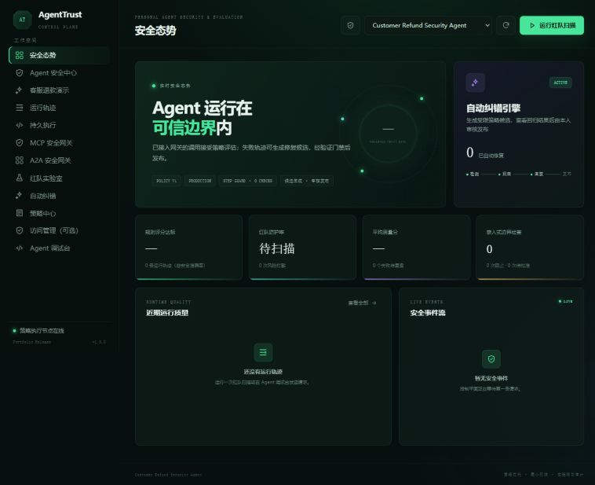
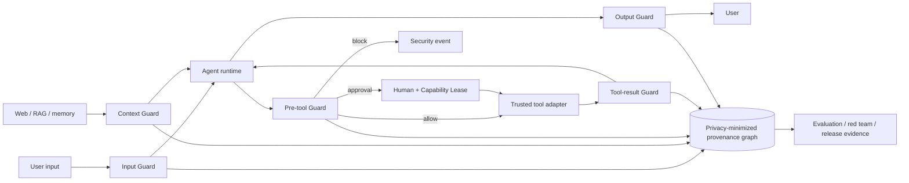

# AgentTrust

**个人使用的 Agent 运行时安全、评测与受限策略纠错实验台。**


AgentTrust 对已接入路径的输入、上下文、工具调用、工具结果和最终输出执行安全检查，生成受限策略候选。v1.0 默认由本人查看回放结果并审核发布；不自动改业务代码。SQLite 和模拟工具即可运行，企业集成不是个人使用的前置条件。

> **当前版本 v1.0.0 Portfolio Release。** 先阅读 [个人使用指南与安全边界](docs/PERSONAL_USE.md)。本版包含五阶段 Step Guard、会话来源图、污点传播、危险动作链、可复现实验清单、OpenAI Agents SDK 工具边界适配和 Promptfoo 外部评测入口；付款／邮件仍为模拟。以下企业能力是可运行的作品集实现，不代表已完成生产验收。



## 三分钟看懂产品



招聘方可以按这一条证据链审阅项目：运行安全演示 → 查看脱敏来源图 → 触发执行前阻断 → 运行单轮／多轮红队 → 导出 Run Manifest → 比较策略回归 → 人工发布或回滚。可验证事实、复现命令和不能夸大的边界集中在 [Portfolio Evidence](docs/PORTFOLIO_EVIDENCE.md)。

## 核心能力

- Agent Gateway：输入、工具、输出三层确定性防护。
- Embedded Step Guard：输入、RAG/记忆、工具执行前、工具结果和最终输出的五阶段策略判定与脱敏审计。
- Framework Adapter：OpenAI Agents SDK 异步 function tool 在执行前和结果返回模型前调用 AgentTrust；控制面异常时失败关闭。
- Provenance & Taint：只保存内容哈希和来源标签的会话图；不可信上下文流向副作用工具时强制审批，敏感来源流向出站工具时直接阻断。
- Customer Refund Security：客户/订单/金额一致性校验、Prompt Injection 拒绝、低风险自动处理、高风险 Temporal 审批和一次性退款能力令牌。
- MCP Security Gateway：Streamable HTTP JSON-RPC 代理、Manifest Pinning、Schema Diff、工具投毒与 Rug Pull 隔离。
- Policy-as-Code：允许、拒绝、人工审批、预算和凭据检测。
- Trace Explorer：请求、策略版本、工具、质量、安全和延迟全链路记录。
- Red Team Lab：9 类攻击插件，支持 direct、Base64、多语言和共享会话的多轮策略；轮次、费用、随机种子与提前停止条件均受控。
- External Benchmark：固定 Promptfoo 0.122.2 通过公开 Gateway API 运行独立 smoke benchmark；当前提交的 JSON/HTML 报告为 4/4 通过（仅证明四条回归用例）。
- Reproducible Evidence：每次评测／红队运行记录策略、数据集、逐例结果、模型、构建版本与配置哈希，并提供基线／候选逐例差异 API。
- Reviewed Correction：30 条主回归 + 12 条合成 holdout、数据集指纹、自定义集复核、人工发布与不可变回滚；小样本规则回放不能代表真实 Agent 准确率。
- Durable Workflows：本地状态机用于零依赖演示；生产退款流由 Temporal 执行审批信号、重试和持久恢复。
- Agent Observability：真实 OTel SDK 批量导出 OTLP 到 Phoenix，同时保留本地可检索 Agent Span。
- Trusted Tool Runner：仅运行注册 Adapter，副作用工具使用参数与目标绑定的一次性租约；有并发和等待时间限制，没有 OS 强隔离或线程硬终止。
- Enterprise Access：组织、工作空间、成员角色、OIDC/JWKS 验签、哈希 API Key、Scope、RPM、月度预算和租户资源授权。
- Security Operations：安全事件中心、防篡改哈希审计链、SSRF 防护、流式请求限额、安全响应头与依赖审计。
- A2A Security Gateway：Agent Card 来源校验、Hash Pinning、Skill Diff、Card Rug Pull 与跨 Agent 消息防护。
- Product Console：安全态势、轨迹、红队、纠错、策略与 Agent 调试台。
- Tenant Isolation：业务表 FORCE RLS、事务级租户上下文、非超级用户启动检查、离线迁移与 PgBouncer 配置。
- Data Protection：输入/输出/工具参数/审计 DLP，覆盖常见 PII、卡号、病历标识与密钥；非通用 PHI 识别器。
- Online Correction Guard：真实请求分流、服务端延迟/错误采样、人工标签、误杀率/召回率/置信区间、并发安全晋级与 SLO 回滚。
- Security Response：跨执行边界 Kill Switch、签名审计锚点、可重试 Outbox、Webhook 与可选 S3 Object Lock 适配。
- Security Intelligence：会话阶段检测、已登记资产风险关联、组合检测器、自托管语义检测器 HTTP 接口。
- Phoenix Experiments：官方 SDK 导出内置数据集、基线/候选实验和 Prompt 版本；本地脱敏策略回放不执行副作用工具。

## 技术栈

- Backend：Python 3.12、FastAPI、Pydantic、PostgreSQL/SQLite、HTTPX、PyJWT。
- Frontend：React、TypeScript、Vite、原生 CSS 可视化。
- Model/Agent adapter：内置 Demo、Qwen/OpenAI Chat Completions、默认关闭且必须显式配置完整 URL 白名单的通用外部 Agent。
- Production：PostgreSQL 18、Temporal、OpenTelemetry OTLP、Arize Phoenix、Docker Compose。

## 快速启动（Windows / VS Code）

完整的目录说明、首次安装命令、VS Code 一键任务、单端口预览和故障排查见 [Windows 与 VS Code 本地运行指南](docs/WINDOWS_VSCODE_RUN.md)。

### 1. 后端

```powershell
cd backend
python -m venv .venv
.\.venv\Scripts\Activate.ps1
pip install -r requirements-dev.txt
python -m uvicorn app.main:app --reload --port 8010
```

访问 `http://127.0.0.1:8010/docs` 查看 API。默认仅在本机运行。

### 2. 前端

```powershell
cd frontend
npm install
npm run dev
```

访问 `http://127.0.0.1:5173`。先进入“客服退款演示”：¥30 展示模拟自动退款，¥60 展示人工审批，勾选恶意输入展示攻击拒绝。再运行红队扫描，在纠错页审核候选，不会默认自动部署。

完成 `npm run build` 后，FastAPI 也会直接托管 `frontend/dist`。此时只启动后端并访问 `http://127.0.0.1:8010`，即可使用同源生产预览，无需额外的 Vite 进程。

也可以在项目根目录执行：

```powershell
.\scripts\start-dev.ps1
```

## 接入 Qwen

真实模型调用前还必须配置模型输入／输出的美元费率，系统据此执行单次费用预检和输出 Token 上限。未配置价格时拒绝调用，详见个人使用指南。内置 demo 不需要 Key 或价格。

可参考 `backend/.env.example` 配置环境变量；如使用 `backend/.env`，启动时显式加 `--env-file .env`。不要把真实 Key 写进代码或提交到 Git。平台共享 Key 仅能发送到部署级 `AGENTTRUST_MODEL_ENDPOINT_ALLOWLIST` 中的完整地址，租户不能自行扩大白名单。

通过 `POST /api/v1/projects` 创建项目：

```json
{
  "name": "My Qwen Agent",
  "description": "Production customer agent",
  "adapter": "openai_compatible",
  "endpoint": "https://dashscope.aliyuncs.com/compatible-mode/v1",
  "model": "qwen-plus",
  "environment": "staging",
  "auto_correct": true
}
```

## 与星限的作品集关系

AgentTrust 与星限是两个完全独立的项目，不存在代码依赖、部署依赖或运行时联动要求，也不需要修改星限。简历中可将星限用于证明 Agent 应用、编排和产品交付能力，将 AgentTrust 用于证明运行时安全、评测、可观测性和受控发布能力。

仓库保留通用 `external_agent` 适配器，只用于对显式加入部署白名单的兼容 API 做黑盒演示。外部目标白名单默认为空；该适配器不会写入或修改目标项目，也不能把调用后的检查解释为阻止了上游已经发生的副作用。竞品对照和本版取舍见 [竞品与产品成熟度评审](docs/COMPETITIVE_INTEGRATION_REVIEW_2026-09.md)。

## 生产 SaaS 启动

生产 Compose 不使用 SQLite，也不提供默认数据库密码：

```powershell
$env:POSTGRES_PASSWORD = "使用密码管理器生成的 URL-safe 强密码"
$env:POSTGRES_APP_PASSWORD = "另一个独立的 URL-safe 强密码"
$env:AGENTTRUST_AUDIT_ANCHOR_SECRET = "至少32随机字节的独立签名密钥"
$env:AGENTTRUST_BOOTSTRAP_TOKEN = "至少32随机字节的独立初始化令牌"
$env:AGENTTRUST_OIDC_ISSUER = "https://id.example.com/"
$env:AGENTTRUST_OIDC_AUDIENCE = "agenttrust-api"
docker compose up --build
```

以上为占位值，必须替换。Compose 先执行迁移，再以 `agenttrust_app` 通过 PgBouncer 运行 API/Worker；迁移凭据不注入 API。服务端口仅绑定环回地址。首次 Key 初始化必须带 `X-AgentTrust-Bootstrap`；控制台“连接凭证”支持 Key/OIDC Token，只存内存、不写浏览器持久存储。OIDC 不会因首次登录创建高权限身份。

Phoenix 在 `http://127.0.0.1:6006`，仅应供平台运维访问，不直接对租户公开。Compose 当前没有打包前端镜像；前端需单独构建/托管并配置同源反代。首次使用和既有数据库升级见 [运维手册](docs/RUNBOOK.md)，特别注意 PostgreSQL 18 卷路径与 Temporal v2 队列迁移。

## 验证

```powershell
.\scripts\verify.ps1
```

该命令运行 Ruff 静态检查、Bandit 安全扫描、后端集成测试和前端生产构建。GitHub CI 还会执行覆盖率门禁、PostgreSQL/RLS 测试、pip-audit、npm audit、CodeQL、依赖审查，并生成 CycloneDX SBOM；Release 工作流生成校验和与构建来源证明。Dependabot 每周检查 Python、npm、Docker 和 GitHub Actions 依赖。

## 项目结构

```text
AgentTrust/
├─ backend/
│  ├─ app/main.py                 # FastAPI 与产品 API
│  ├─ app/db.py                   # SQLite/PostgreSQL 存储、事务与哈希审计链
│  ├─ app/services/policy.py      # 确定性策略引擎
│  ├─ app/services/gateway.py     # Agent 运行时网关
│  ├─ app/services/guard.py       # 五阶段执行边界、来源图与污点传播
│  ├─ app/services/evidence.py    # 内容寻址 Run Manifest 与逐例差异
│  ├─ app/integrations/openai_agents.py # OpenAI Agents SDK 工具边界适配
│  ├─ app/routers/evaluations.py  # 评测与红队 API 域路由
│  ├─ app/services/mcp_gateway.py # MCP JSON-RPC 代理与供应链安全
│  ├─ app/services/a2a_gateway.py # A2A Agent Card 与消息安全
│  ├─ app/services/workflows.py   # 持久工作流与审批恢复
│  ├─ app/services/sandbox.py     # 能力租约与受限工具执行
│  ├─ app/services/observability.py # OTel-shaped Agent Span
│  ├─ app/services/access_control.py # 多租户、RBAC、API Key 与预算
│  ├─ app/services/oidc.py        # OIDC/JWKS 严格验签
│  ├─ app/services/refunds.py     # 客服退款安全业务域
│  ├─ app/services/temporal_orchestrator.py # Temporal 客户端
│  ├─ app/temporal_workflows.py   # 退款 Workflow 与 Activity
│  ├─ app/temporal_worker.py      # 独立 Temporal Worker 入口
│  ├─ app/services/evaluation.py  # 独立回归评测器
│  ├─ app/services/redteam.py     # 插件化攻击与变异策略
│  └─ app/services/correction.py  # 自动纠错、发布门禁与回滚
├─ frontend/                      # AgentTrust 企业控制台
├─ examples/requests.http         # VS Code REST Client 演示
├─ benchmarks/promptfoo/          # 独立外部评测入口
├─ docs/ARCHITECTURE.md           # 架构、边界与 V1-V4 路线
├─ docs/INTERVIEW_GUIDE.md        # 面试讲法与三分钟演示
├─ docs/PORTFOLIO_EVIDENCE.md     # 招聘方可复核事实与证据索引
├─ docs/PRODUCT_POSITIONING.md     # 产品定位、功能成熟度和人工评审入口
├─ docs/PRODUCTION_ARCHITECTURE.md # v0.4 生产架构、威胁模型与后续路线
├─ docs/SECURITY_AUDIT_2026-08.md # 本轮安全审计、修复证据与剩余风险
└─ docker-compose.yml
```

## License 与安全报告

代码采用 [MIT License](LICENSE)。安全问题请按 [.github/SECURITY.md](.github/SECURITY.md) 私下报告，不要在公开 Issue 中附带秘密、个人数据或可直接利用的载荷。

## 自动纠错安全边界

AgentTrust 不允许模型直接改生产代码。自动发布仅适用于通过完整回归的 `policy-only` 补丁；Prompt 和代码类修复始终进入人工审核。详见 [架构设计](docs/ARCHITECTURE.md)。

## 当前边界

- 已增加业务表 RLS、离线迁移和连接池；认证引导表仍有应用层授权边界。RLS 不能抵御持有数据库凭据、可自行设置租户上下文的攻击者。
- 内置 30 条自动纠错发布回归可证明当前策略集表现，不能代表真实世界通用准确率；生产仍需租户级标注集、时间切分 holdout、人工抽检与漂移监控。
- MCP 当前实现 HTTP JSON-RPC 运行时代理；stdio/SSE 会话桥接、OAuth 凭据代理和远程自动发现仍需继续完善。
- Canary 已接真实网关流量与人工标签；当前按最多 5000 条请求计算，没有顺序统计检验、独立标注平台或全链路会话绑定，不承诺真实世界准确率。
- Temporal、OTel/Phoenix 与 OIDC 已真实接入，但本地默认关闭；生产可用性仍依赖 HA Temporal、OTel Collector、IdP 和 PostgreSQL 运维。
- OIDC 已验签并 fail closed；SCIM、会话撤销、服务账号轮换、细粒度 ABAC 尚未实现。
- 签名锚点与 Outbox 已实现；外部 WORM 仅在实际成功投递后生效。Webhook/S3 未配置时不能宣称已有异地防篡改保护。
- Sandbox 不执行任意用户代码；如果后续开放代码工具，应将 Adapter Worker 替换为 Docker/gVisor/E2B 等强隔离运行时。
- 外部 Agent 目标采用部署级完整 URL 白名单且默认不允许任何地址；生产需 HTTPS 与服务端 Bearer Token。外层代理无法撤销上游已经执行的副作用。
- `/api/v1/guard/check` 在五类边界返回 `allow / block / approval_required`；来源图只保存内容 SHA-256、来源标签和父节点，不保存原始上下文。需要批准的动作仍须走 Capability Lease 或 Durable Workflow，Guard 响应本身不是授权凭证。
- 来源标签来自受信接入端和系统推导，不能证明数据内容真实；个人演示以保守传播为主。生产还需要框架级 Adapter、字段级映射治理和会话保留策略。
- 实验清单可证明同一仓库内产物身份和逐例差异，不能证明数据独立、模型行为确定或真实世界准确率；构建版本未由 CI 注入时会明确显示 `unreported`。

完整迭代路线见 [docs/ARCHITECTURE.md](docs/ARCHITECTURE.md)，当前产品边界见 [docs/PRODUCT_POSITIONING.md](docs/PRODUCT_POSITIONING.md)，本轮安全结论见 [docs/SECURITY_AUDIT_2026-08.md](docs/SECURITY_AUDIT_2026-08.md)，面试展示见 [docs/INTERVIEW_GUIDE.md](docs/INTERVIEW_GUIDE.md)。

历史评审文档只记录当时状态；最新实现、验证证据和限制以 [Portfolio Evidence](docs/PORTFOLIO_EVIDENCE.md)、[v1.0 竞品评审](docs/COMPETITIVE_INTEGRATION_REVIEW_2026-09.md) 与 [Changelog](CHANGELOG.md) 为准。
